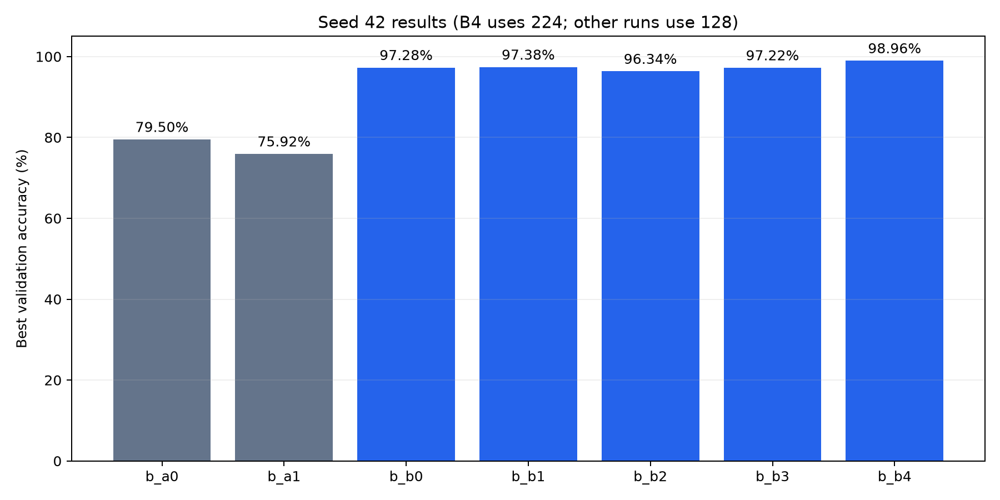
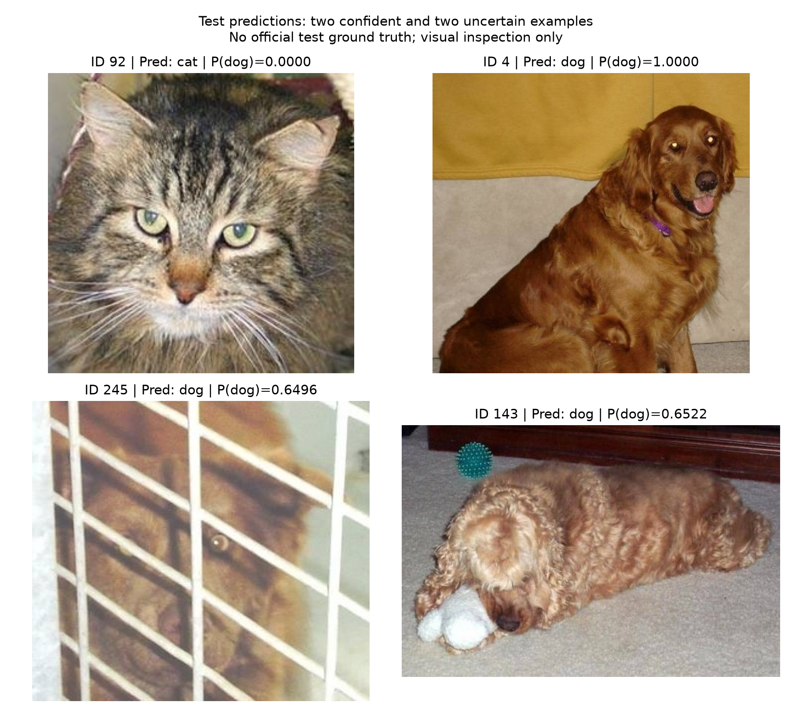
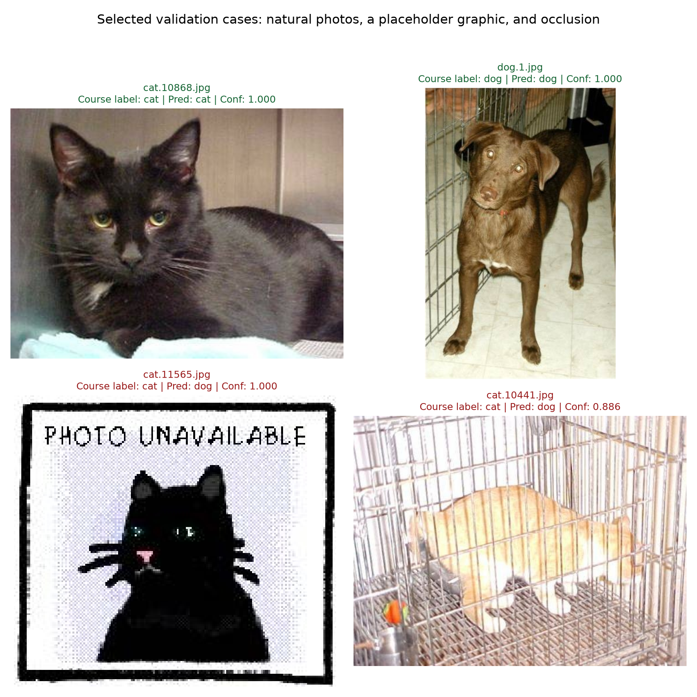

# EE6483 Team 69 — B模块实验与交付报告

本报告仅覆盖本次上传快照上的B模块开发和实测。全部结果来自真实训练日志。A模型对照由本次B工作复跑，不代表A成员已交付的结果；C代码未实现或修改。GitHub私有仓库访问返回404，未推送远端。

## 1. 数据与实验设置

采用课程原始划分：训练20,000张（猫狗各10,000），验证5,000张（各2,500），测试500张。测试无标签，仅在验证集选型后作预测。标签cat=0、dog=1。全部25,500张图片均成功解码。课程数据来源、压缩包大小和SHA256见report_assets/b_team69/b_data_source.json，预训练权重来源与SHA256见report_assets/b_team69/b_pretrained_source.json。
原始字节SHA256发现5组完全重复图片，其中1组跨训练/验证：train/cat/cat.2339.jpg 与 val/cat/cat.12408.jpg。主结果保留课程划分，另报告排除该验证图后的4999张敏感性准确率。未执行感知近似重复搜索。

所有主要对照：相同清单、seed42、128×128 RGB、batch32、10轮、AdamW、weight decay=1e-4、无学习率调度、num_workers=4、CPU线程4。训练增强为水平翻转0.5和旋转±15°；验证和测试无随机增强。归一化沿用ImageNet mean/std。不同架构每轮算力不同，固定轮次并不等于固定计算量。

## 2. 模型与参数选择

ResNet18使用torchvision IMAGENET1K_V1权重，替换为Linear(512,2)，输出原始logits，采用CrossEntropyLoss。head模式只训练分类头；layer4模式训练最后一个残差阶段（含两个BasicBlock）及分类头。冻结层同时保持BatchNorm统计不变。模型结构图见report_assets/b_team69/b_resnet18_architecture.png。
先比较增强开关与解冻范围，再在较好的增强模式中将学习率由分类头1e-3/骨干1e-4降低至3e-4/3e-5。随后对增强方案胜者单独测试224输入。128/224均采用共享正方形resize，不是官方256短边resize+224中心裁剪协议；该差异已记录。ImageNet预训练使用额外外部监督信息，准确率提升不能只归因于ResNet结构。

最终模型总参数11,177,538，可训练参数8,394,754；head-only仅更新分类头的1,026个参数，但仍需执行整个骨干的前向计算。实测时间也受图片处理与设备状态影响，不能仅按可训练参数量推断总耗时。

最佳模型按验证accuracy最大、同分val loss最小选择。所有种子训练固定10轮；没有基于测试集调整参数。

## 3. 真实实验结果

|运行|模型/解冻|增强|尺寸|种子|最佳验证accuracy|所选checkpoint val loss|最佳轮次|训练+验证耗时秒|
|---|---|---|---|---|---|---|---|---|
|b_a0_seed42|baseline_cnn/full|False|128|42|79.50%|0.45572|9|243.5|
|b_a1_seed42|baseline_cnn/full|True|128|42|75.92%|0.50937|9|283.5|
|b_a1_seed43|baseline_cnn/full|True|128|43|75.80%|0.51144|6|250.1|
|b_a1_seed44|baseline_cnn/full|True|128|44|74.46%|0.52191|6|231.4|
|b_b0_seed42|resnet18/layer4|False|128|42|97.28%|0.09199|4|257.8|
|b_b1_seed42|resnet18/layer4|True|128|42|97.38%|0.09679|8|277.1|
|b_b2_seed42|resnet18/head|True|128|42|96.34%|0.09312|7|270.1|
|b_b3_seed42|resnet18/layer4|True|128|42|97.22%|0.07259|5|288.8|
|b_b4_seed42|resnet18/layer4|True|224|42|98.96%|0.04165|6|470.0|
|b_final_seed43|resnet18/layer4|True|224|43|98.88%|0.05150|10|464.6|
|b_final_seed44|resnet18/layer4|True|224|44|98.86%|0.03803|5|379.0|

128控制组：基础CNN增强效应 -3.58 个百分点；ResNet18 layer4增强效应 +0.10 个百分点；相同增强下B1相对A1 +21.46 个百分点。
224尺寸实验B4相对其128起点b_b1_seed42的验证准确率变化为+1.58个百分点；仅为本次固定种子下的尺寸对照。
这些是本次固定预算和选定配置下的结果；负增益必须如实报告，不能预设增强必然提高准确率。公共CNN仅按默认学习率在10轮预算内复跑，未进行与B同等范围的超参数搜索；该比较代表当前方案和训练预算，不能证明架构本身的因果优势或充分收敛后的性能上限。最佳单次验证结果包含调参选择效应，不是独立未见测试集上的准确率。

## 4. 最终选择、独立复核与稳定性

最终提交使用seed42的 `b_b4_seed42`，模式layer4，输入224，增强True，头学习率0.001、骨干学习率0.0001。未从seed43/44中再次挑选提交模型。
独立加载checkpoint后的完整验证集accuracy=98.96%，loss=0.04165，macro-F1=0.98960。排除已知跨集合重复图后的accuracy=98.96%（n=4999）。
最终配置seed42/43/44各自最佳验证accuracy：[98.96, 98.88, 98.86]；均值±样本标准差：98.90% ± 0.05 个百分点。增强基础CNN（128输入）对应三次：[75.92, 75.8, 74.46]；75.39% ± 0.81 个百分点。
三次实验只用于稳定性描述，不足以宣称统计显著；各次均以验证集选最佳轮次。若最终方案使用224而baseline使用128，这一多种子比较包含分辨率差异；单因素架构/增强结论以128控制矩阵为准。

逐类指标：

|类别|precision|recall|F1|
|---|---|---|---|
|cat|0.99355|0.98560|0.98956|
|dog|0.98571|0.99360|0.98964|

混淆矩阵（行真实cat/dog，列预测cat/dog）：[[2464, 36], [16, 2484]]。

## 5. 案例分析与提交

验证案例来自 `runs/b_b4_seed42/evaluation/`：correct_examples.png、incorrect_examples.png、predictions.csv。测试没有真实标签，因此不能自动标注测试正确/错误，也不能报告测试accuracy。测试概率明细仅用于查看模型输出，人工观察不能代替真实标签。
最终submission.csv严格按sampleSubmission的1–500顺序写入整数0/1，概率另存test_predictions.csv。文件位于 runs/b_final_submission/submission.csv；概率明细及模型、manifest哈希见同目录 test_predictions.csv 和 provenance.json。

### 实际案例讨论

以下案例是在模型配置固定后选取的定性说明，不是额外调参或重新筛选验证集。

**测试案例1：ID 92。** 图中可见正面的猫脸、尖耳与胡须，模型预测cat，P(dog)约1.98×10^-33，与人工视觉判断一致。主体清晰且脸部细节充分，与模型能够识别典型猫脸形态的解释一致。这是人工观察的一致性说明，不是官方测试正确标签，也不能由这一张推导测试准确率。

**测试案例2：ID 245。** 图中的动物面部被白色栏杆明显遮挡，画面模糊；人工观察倾向于狗，模型也输出dog，但P(dog)仅0.6496，是本次测试中最接近0.5的预测。与ID 92相比，遮挡削弱了可见的脸部形态，体现了困难输入下置信度降低的现象。没有官方标签，因此将它记作“遮挡下的低置信度案例”，不宣称测试错误或以人工判断计算准确率。ID 143的蜷卧姿态及不清晰的脸部也给出了接近的P(dog)=0.6522，见图中补充展示。

测试案例图：report_assets/b_team69/b_test_case_predictions.png。选择包括两个最自信的示例和两个最接近0.5的示例，并非对500张测试图片的无偏抽样。

**有标签验证集的对照。** cat.10868.jpg和dog.1.jpg均包含较清晰的自然动物外形，预测与课程文件夹标签一致。cat.11565.jpg实际为带有“PHOTO UNAVAILABLE”文字的猫形占位图，课程标签为cat，模型却以接近1的置信度预测dog。这提示模型对非自然照片输入的适应存在局限，而且高softmax置信度不保证正确。cat.10441.jpg在密集笼栏遮挡下被错分为dog，提示遮挡和背景结构仍是薄弱点。上述错误都保留在原始5000张验证指标中，没有为提高成绩而删除。

案例选择与原始预测数值见report_assets/b_team69/b_validation_case_selection.json；清晰排版的图见report_assets/b_team69/b_validation_case_analysis.png。案例机制是基于图像的解释，未用特征归因实验验证因果关系。

## 6. 复现与小组交付

代码入口、操作步骤见B_GUIDE.md，审查与矩阵见B_PLAN.md。精确依赖版本见report_assets/b_team69/b_environment_lock.txt；每个实验config.json含环境、源代码哈希和manifest哈希。history.csv记录逐轮loss/accuracy/lr/耗时；独立评估包含逐类指标和预测；完整工作副本保留各次运行的最佳与最近模型。交付ZIP为控制体积，仅包含最终模型 runs/b_b4_seed42/best_model.pt；所有正式实验的配置、日志、清单和图仍完整包含。
本次设备为RTX2060 6GB，Python/PyTorch/CUDA信息见config。固定随机种子并启用deterministic算法，但沿用公共工具的warn_only=True；跨设备/版本不能保证逐位一致。临时训练环境和解压数据位于/tmp，原始数据压缩包已持久保存于downloads。
全部原始17个代码/配置/清单文件逐字节保持不变；新增内容仅在B模块、B文档及独立结果目录。未完成组内文献综述或C的CIFAR-10/不平衡任务，不将B交付等同于全组完成。

参考：课程EE6483-Project2.pdf；He et al., Deep Residual Learning for Image Recognition, CVPR 2016；https://docs.pytorch.org/vision/stable/models/generated/torchvision.models.resnet18.html ；https://docs.pytorch.org/tutorials/beginner/transfer_learning_tutorial.html 。

交接包说明：本包的可提交素材位于report_assets/b_team69/；各实验轻量记录位于其experiments/子目录。模型和所选运行的本地结果位于02_LOCAL_RESULTS/runs/，复制到仓库根目录后才能按原runs路径加载。不要用完整旧仓库覆盖A/C的新版本。
